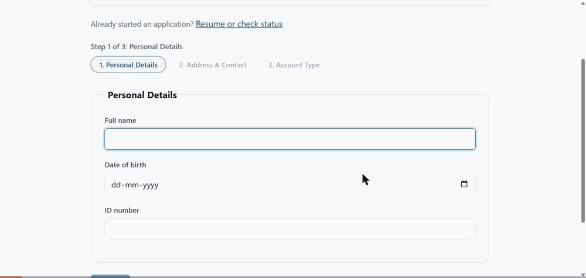
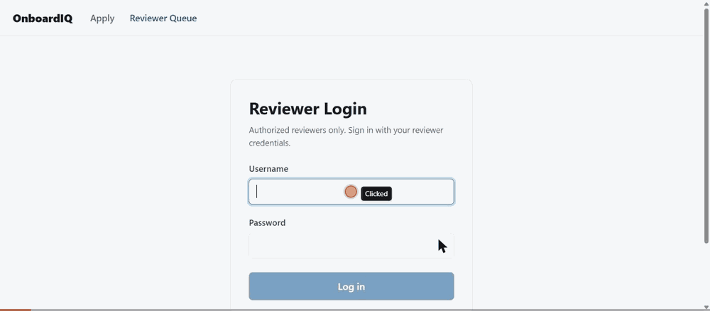
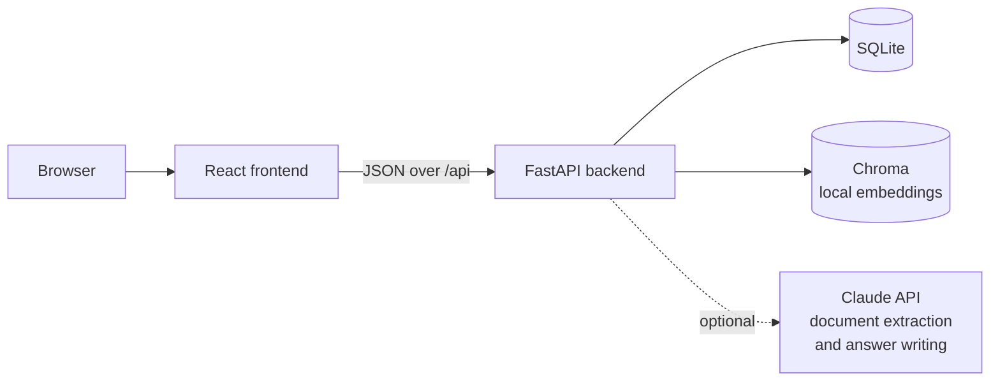

# OnboardIQ — AI-Powered Banking Onboarding

Version 1.0

**Opening a bank account online: AI checks the applicant's identity
documents against the form and explains what it found, and a person makes
every decision.**

- **What it does:** applicants fill in a 3-step form and upload an
  identity document; the backend extracts the document's fields with AI,
  compares them with the submitted data, and computes an advisory risk
  level; reviewers work a queue and approve, reject, or request more
  information. A policy assistant answers onboarding questions from the
  bank's policy documents, with citations.
- **Design principles:** no auto-approval (only a logged-in reviewer's
  decision can approve an application), explainability (every AI result
  carries a plain-language justification), an append-only audit log, and
  graceful degradation (if the AI fails, the application goes to manual
  review instead of erroring).
- **Stack:** React 18 + Vite frontend, FastAPI backend, SQLite via
  SQLAlchemy, Chroma for local policy-document embeddings, and the
  Anthropic Python SDK for the Claude calls.
- **The business problem:** staff re-read IDs and re-type details by hand,
  which means slow turnaround, high cost and uneven decisions; the reason
  behind a decision is often never recorded; and full automation isn't
  acceptable in a regulated industry ([PRD §1](docs/PRD.md)).
- **Why it matters to a bank:** efficiency (reviewers confirm the AI's
  findings instead of re-typing), risk and compliance (the same checks every
  time and an accountable person behind each decision support compliance
  work), customer experience (a reference ID straight away and status at any
  time), and auditability (an append-only, exportable decision record;
  rejections need a reason). The PRD's targets, a 15-minute manual review
  becoming a 30-second confirmation and submission to decision in under a
  minute, are design targets and have not been measured.
- **Skills:** Python, JavaScript, React, HTML (JSX), CSS, FastAPI, REST APIs,
  SQLite, Claude API, prompt design, RAG search, automated testing (255
  backend + 30 frontend tests), accessibility, requirements writing, Git and
  GitHub.
- **Fixes:** 11 bugs and 1 documentation error fixed, plus 1 known gap, each
  listed with its evidence in [docs/FIXES.md](docs/FIXES.md).

**Recruiter demo:** <https://claude.ai/artifact/3CB13otWJeAGWHPWMwdhLG>



*Applicant: the 3-step form, submission with a reference ID, and the ID
document upload.*



*Reviewer: login, the queue, the AI comparison and risk factors for a
flagged application (simulated AI results), and a Request More
Information decision recorded in the audit log.*



AI results in this version are simulated. The Claude integration is built
and tested against mocked responses; live API calls are pending account
activation.

OnboardIQ is not hosted publicly. It runs locally on your machine; see
[Running locally](#running-locally) for the setup steps.

Portfolio project demonstrating "domain + AI infusion" in banking onboarding.
See [docs/PRD.md](docs/PRD.md) for the full product requirements and
[CLAUDE.md](CLAUDE.md) for the non-negotiable design principles this project
is built against.

## Status: all 6 phases of the PRD build sequence complete

See [docs/PROGRESS.md](docs/PROGRESS.md) for the up-to-date, per-phase status.
Implemented: application intake, document upload, and save-and-resume
drafts (Phases 1 & 6's US-03); AI document extraction and
cross-verification (Phase 2 — code-complete, verified against mocked LLM
responses; a real API key is not yet available, see PROGRESS.md); the
reviewer queue, side-by-side review screen, and approve/reject/request-info
decision flow, including the full resubmission loop after Request More
Information (Phase 3 + Phase 6's US-25); composite risk scoring
(including a declared-vs-detected document type check), rule-based checks,
risk breakdown, and queue sort/filter/ageing (Phase 4 + Phase 6's
US-08/US-15); a RAG policy assistant answering onboarding questions from
ingested policy documents, with citations (Phase 5 — retrieval is real and
local, no API key needed; only the final answer-synthesis call needs one,
see PROGRESS.md); document replacement with version retention for audit
(Phase 6's US-07); and CSV/JSON audit trail export (Phase 6's US-28). All
30 user stories in `docs/PRD.md` are implemented.

**Beyond the PRD:** a minimal reviewer login (see "Reviewer login" below) —
not one of the 30 stories, added afterward as a small, contained,
additive feature.

## Design principles (non-negotiable — see CLAUDE.md)

- **No auto-approval.** `ApplicationStatus.APPROVED` can only ever be
  assigned from one place in the entire codebase: `crud.create_decision`,
  which is only reachable through `POST /api/applications/{id}/decision` —
  an endpoint that requires a logged-in reviewer session (see "Reviewer
  login" below). The AI pipeline (`app/pipeline.py`) never references
  `APPROVED` at all. This is enforced by an automated, whole-codebase test
  (`backend/tests/test_no_auto_approval.py`), not just a code review
  convention — it scans every source file and fails if the string
  `ApplicationStatus.APPROVED` ever appears anywhere outside that one
  function.
- **No unexplained AI output.** Every extracted field and every
  submitted-vs-extracted comparison carries a plain-language justification
  before it can render. The frontend's `AIValue` component enforces this
  structurally: it refuses to display a value at all if no justification is
  present, rather than relying on every call site remembering to check.
- **Append-only audit log.** `AuditLogEntry` rows are only ever inserted,
  never updated or deleted — there is no such function in `crud.py` and no
  such route in the API.
- **Graceful degradation.** If the LLM is unavailable or its response can't
  be parsed, the application is routed to manual review with a plain
  explanation — it never returns an error to the applicant.

## Project layout

```
backend/    FastAPI application (Python)
frontend/   React application (Vite)
docs/       PRD and other product documentation
```

## Running locally

### Prerequisites

- **Python 3.10+** (the codebase uses `X | None` type-union syntax
  throughout, which requires it). Tested on **3.12** specifically —
  `requirements.txt` pins `chroma-hnswlib==0.7.5` because newer releases
  ship no prebuilt wheel for Windows/`cp312` and fail to build without
  MSVC Build Tools, so 3.12 is the version this project is actually
  verified against.
  **Python 3.12 is recommended.** On 3.13 there is no prebuilt wheel for
  the pinned `chroma-hnswlib` (or for `numpy`), so pip builds them from
  source and may need a C compiler.
- **Node.js 18+** (required by Vite 5).

### Backend

Windows (PowerShell):

```powershell
cd backend
python -m venv .venv
.venv\Scripts\activate
pip install -r requirements.txt
copy .env.example .env
uvicorn app.main:app --reload --port 8000
```

macOS/Linux:

```bash
cd backend
python3 -m venv .venv
source .venv/bin/activate
pip install -r requirements.txt
cp .env.example .env
uvicorn app.main:app --reload --port 8000
```

The first run downloads an embedding model of about 79 MB and may print
harmless `ERROR chromadb.telemetry` lines; startup still completes.

`ANTHROPIC_API_KEY` in `.env` can be left **blank** — this is a supported,
intentional way to run the whole app. Document extraction and the RAG
assistant's answers both degrade gracefully to manual review /
"unavailable" rather than erroring out (see "Design principles" above).
If you want live AI extraction and RAG answers, get a key from
[console.anthropic.com](https://console.anthropic.com) and set it there.

Demo reviewer credentials are intentionally committed in plaintext
(`backend/reviewer_accounts.json`) for local evaluation only — this
pattern is not used for any real user data and would not be appropriate
for a production deployment. Log in at `/reviewer/login` with
`reviewer_1`, `reviewer_2`, or `reviewer_42`, password `changeme123` for
all three (see "Reviewer login" below for the full rationale) — the login
page itself no longer displays these, by design.

The API is served at `http://localhost:8000`. SQLite data lives in
`backend/data/`, uploaded files in `backend/storage/`, and the local RAG
vector store in `backend/data/chroma/` — all git-ignored and created
automatically on first run. The sample policy documents in
`backend/policy_documents/` are ingested automatically on startup if the
vector store is empty; if you edit them, re-ingest explicitly:

```bash
cd backend
python -m app.rag.ingest_cli
```

The very first time this ingestion runs (whether via startup or the CLI
above), Chroma downloads a small (about 79 MB) local embedding model to a
machine-wide cache (`~/.cache/chroma/`) — this needs internet access
once, but is not per-clone: every project on the machine that uses
Chroma's default embedding function shares it afterward. Because of this,
the **first** `uvicorn` startup takes a few seconds longer than
subsequent ones — that's expected, not a hang.

To populate the reviewer queue with one demo application (a mismatch flag
and a HIGH risk breakdown) instead of applying through the UI, stop the
backend first (it needs the database file free), then, with the virtual
environment still active, run from the repository root:

```bash
cd backend
python seed_demo.py --reset
```

Run it from inside `backend/`: the database path is relative to the
folder you run it from, so running the script from another folder seeds
a different database file than the one the backend reads. Use
`python seed_demo.py --reset --full` to also seed four more applications
in varied states (approved, rejected, info-requested, an overdue pending
one) so the reviewer queue's summary stats bar has real numbers to show;
see `python seed_demo.py --help` for details. Then start the backend again.
The extraction it shows is simulated, not a real Anthropic API call,
since `ANTHROPIC_API_KEY` is left blank by default for local dev.

Run the backend test suite:

```bash
cd backend
pytest
```

### Frontend

```bash
cd frontend
npm install
npm run dev
```

The dev server runs at `http://localhost:5173` and proxies `/api` requests
to the backend on port 8000 (see `frontend/vite.config.js`).

Run the frontend's unit tests (plain modules like `validation.js` and
`jumpToApplication.js`, via Node's built-in test runner — this project has
no other frontend test framework):

```bash
cd frontend
npm test
```

## Reviewer login

Not part of the original 30-story PRD — added afterward as a small,
contained addition. Reviewer actions (the queue, and submitting a
decision) require logging in at `/reviewer/login`. Applicants never
authenticate at all; nothing about the applicant flow changed.

Three fixed demo accounts, defined in `backend/reviewer_accounts.json`:

| Username | Password |
|---|---|
| `reviewer_1` | `changeme123` |
| `reviewer_2` | `changeme123` |
| `reviewer_42` | `changeme123` |

This is deliberately **not** a production authentication system: plaintext
demo passwords in a committed config file, and sessions are an in-memory
token map that's cleared on every backend restart (see `backend/app/auth.py`
for the full rationale). A decision's `reviewer_id` is always the logged-in
username — there is no free-text reviewer ID field anywhere in the API or
UI, so a reviewer can no longer attribute a decision to anyone but
themselves.

## Configuration

All thresholds, timeouts, and paths are read from environment variables —
see `backend/.env.example` for the full list. Nothing is hardcoded in
application code (see CLAUDE.md conventions).

## Known limitations

- **Simulated AI in the demo:** The demo's AI extraction results are
  simulated, and extraction has not yet been run against the live
  Anthropic API.
- **Email check:** The form's inline email check accepts a few malformed
  addresses that the server rejects, so those are caught only at final
  submission.
- **In-memory sessions and rate limits:** Reviewer sessions and rate
  limits reset whenever the backend restarts and are not shared across
  multiple server processes.
- **Guessable reference IDs:** Reference IDs are sequential, and anyone
  holding one can read that application's record, documents and current
  decision, edit its draft or upload documents, so the app is safe only
  with sample data.
- **Rate limits behind a proxy:** Rate limits use the address the server
  sees, so behind a hosting proxy every visitor would share one limit.
- **Free text and CSV export:** Free-text fields have no length limit,
  and the CSV audit export does not stop a spreadsheet from treating a
  cell that starts with `=`, `+`, `-` or `@` as a formula.
- **Demo passwords in the repository:** Three demo reviewer accounts with
  one shared plaintext password are committed on purpose, so anyone can
  try the reviewer flow.
- **Frontend dependency advisories:** On 2026-10-31, `npm audit` reported
  5 advisories (2 high, 3 moderate); the 2 high and 1 moderate are in the
  development tooling only, and 2 moderate are in React Router, which
  ships with the app, with fixes that need major-version upgrades.

Full technical detail: [docs/KNOWN_LIMITATIONS.md](docs/KNOWN_LIMITATIONS.md)

## Future enhancements

- Dark theme for the app (it is light-only today).
- Shared storage for rate limits and reviewer sessions, so both survive a
  restart and work correctly across multiple instances.
- Run and validate live AI extraction against the real Anthropic API (the
  integration is built and tested with mocked responses).
- Align the frontend's inline email check with the server's validation.
- The v1.1 reviewer-only public demo, as planned in
  [docs/DEPLOYMENT_PLAN.md](docs/DEPLOYMENT_PLAN.md).
